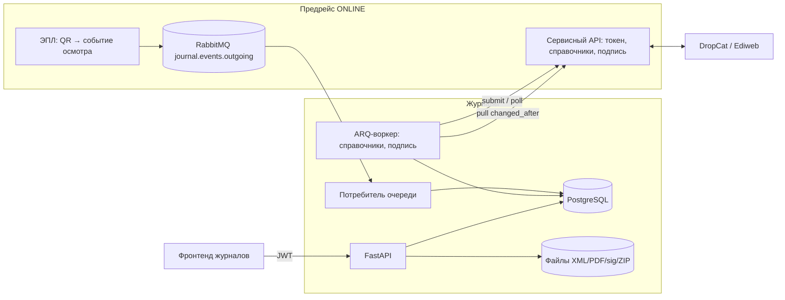

# Архитектура

## Границы систем



- **Источник истины** по пользователям, организациям, водителям, ТС, подписи и ЭПЛ — Предрейс.
  Журналы с DropCat не общаются.
- **Реплики** (`organizations`, `drivers`, `vehicles`, `users`) используют `id` из Предрейса как первичный ключ.
- **Снимок реквизитов** (`snapshot` JSONB) фиксируется в записи в момент осмотра: подписанный документ
  не меняется задним числом при правке справочника.
- **Подпись** выполняет Предрейс (ключи и лицензии там). Журналы отправляют файл и идентификатор
  подписанта, получают `.sig`, TSP и метаданные сертификата.

## Жизненный цикл записи

```
manual / ocr ──► А unsigned ──(подпись специалиста)──► Б signed ──(подпись журнала СА)──► В in_journal
epl (Т2/Т3/Т6) ────────────────────────────────────► Б signed
```

| Статус | Правка | Удаление | Подпись |
|---|---|---|---|
| А | да (кроме ЭПЛ) | да | только свой специалист, без примечания |
| Б | нет | через запрос (Предрейс) → Админ/СА, или напрямую Админ/СА | — |
| Б, `reserved_journal_id` | нет | нет | — |
| В | нет | нет | — |

Правила дублируются в **триггерах БД** (`0002_immutability_triggers`): подписанная запись меняется только
в служебных полях (`status`, `reserved_journal_id`, `deletion_pending`, `updated_at`), запись в журнале
неизменяема, `audit_log` — append-only.

## Модель данных

- `medical_records`, `technical_records` — два журнала с общим миксином; `specialist_user_id` обязателен.
  Уникальность `(epl_waybill_id, epl_title_number)` защищает от дублей из ЭПЛ.
- `record_documents` — электронный документ типа 1 (ссылки на xml/pdf/sig/tsp, метаданные сертификата).
- `e_journals` + `e_journal_items` — электронный журнал (тип 2); запись входит максимум в один журнал.
- `deletion_requests` — частичный уникальный индекс: один `pending` на запись.
- `inbox_events` (идемпотентность по `event_id`), `outbox_events`, `sync_state`.
- `audit_log` — хеш-цепочка (`hash = sha256(prev_hash + canonical_json)`), проверка `verify_chain`.
- `ocr_batches`, `ocr_items` — под распознавание сканов.

Объём: ~1000 записей/сутки (~365 тыс./год). Партиционирование не требуется; достаточно индексов
`(organization_id, performed_at)` и `(status)`. Фильтр по ФИО/госномеру идёт по JSONB-снимку;
при росте — GIN/trigram-индекс.

## Электронный журнал

Состав ZIP, жизненный цикл и проверка целостности — в [container-format.md](container-format.md); форматы XML —
в [xml-schema.md](xml-schema.md). Принципы: подписанные байты записей не перегенерируются; СА подписывает ровно тот
`journal.xml`, что подготовлен при отправке; контейнер самопроверяется перед сохранением.

## Права и доступ

Единый источник — `app/domain/permissions.py`, сверен с таблицей ТЗ тестом `test_permissions.py`.
Доступ к API требует JWT Предрейса с `journals_access=true`. Клиент и диспетчер видят только свою
организацию, **только на ЭПЛ**, **только подписанные записи** и **без медицинских показателей**:
для них используется отдельная схема ответа, где этих полей нет вовсе (а не скрыты стилями).
В PDF медицинские показатели заменяются на `N/A`.

`GET /api/v1/me` отдаёт список прав; каждая запись содержит `actions` — какие кнопки доступны
пользователю в строке архива (`edit`, `delete`, `clear_note`, `sign`, `request_deletion`, `delete_signed`).

## Надёжность интеграции

- Очередь осмотров: сообщения обрабатываются по одному; обработка идемпотентна (`inbox_events` по id сообщения и
  уникальность `(рейс, титул)`). Нераспознанное и «слишком раннее» не блокирует очередь и сохраняется в `inbox_failures`.
- Справочники — pull с отметкой `updated_at`; повторная обработка безвредна.
- Подпись — задачи `sign_jobs` с повторами, таймаутом и защитой от двойной обработки (`FOR UPDATE SKIP LOCKED`,
  перепроверка статуса перед завершением).
- Блокировки: сначала строка записи (`FOR UPDATE`), аудит — всегда последним (advisory lock), чтобы исключить
  взаимные блокировки.
